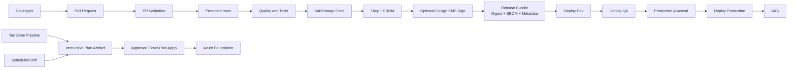

# Azure DevOps Enterprise Pipelines

[](https://github.com/harshilamin/azure-devops-enterprise-pipelines/actions/workflows/portfolio-ci.yml)


A complete portfolio implementation of enterprise Azure DevOps YAML pipelines for application delivery, Terraform infrastructure delivery, security scanning, immutable artifact promotion, environment approvals, drift detection, and rollback.

## What this repository demonstrates

- Reusable stage, job, and step templates instead of copied pipeline YAML.
- Dedicated pull-request validation configured as a branch-policy build.
- Build-once, promote-the-same-digest application delivery to AKS.
- Azure Resource Manager service connections using Workload Identity Federation.
- Azure DevOps Environments for deployment history, security, and approvals/checks.
- Variable groups for non-secret configuration and Azure Key Vault retrieval for secrets.
- Terraform validation, plan artifacts, exact-plan apply, and scheduled drift detection.
- Python quality gates, Helm lint/render validation, Trivy scanning, and CycloneDX SBOMs.
- Optional SonarQube Cloud analysis and quality-gate publication.
- Optional Cosign signing and attestation with an Azure Key Vault key.
- Manual Production validation that prevents self-approval.
- Immutable digest rollback without rebuilding the application.
- Branch-policy, environment, variable-group, and service-connection bootstrap assets.
- Cross-platform local validators and a GitHub portfolio CI workflow.

## Architecture



## Pipeline inventory

| Entry point | Purpose |
|---|---|
| `azure-pipelines.yml` | Main application CI/CD pipeline |
| `azure-pipelines-pr.yml` | Pull-request validation and branch-policy pipeline |
| `azure-pipelines-infrastructure.yml` | Parameterized Terraform plan/apply pipeline |
| `azure-pipelines-drift.yml` | Scheduled Terraform drift detection |
| `azure-pipelines-rollback.yml` | Manual immutable-digest application rollback |
| `azure-pipelines-security.yml` | Scheduled dependency, source, container, Helm, and IaC scanning |

## Environment model

| Environment | Deployment | Approval model | Configuration |
|---|---|---|---|
| Development | Automatic after a successful main build | Azure DevOps Environment security | `pipeline-demo-dev-config` |
| QA | Same digest promoted from Development | Environment approval/check | `pipeline-demo-qa-config` |
| Production | Same digest after manual validation | ManualValidation plus Environment approval/check | `pipeline-demo-prod-config` |

## Repository map

```text
.
├── azure-pipelines*.yml              # Pipeline entry points
├── pipelines/templates               # Reusable variables, steps, jobs, and stages
├── src/pipeline_demo                  # Small FastAPI reference workload
├── deploy/helm/pipeline-demo-api      # Hardened deployment chart
├── infra/terraform                    # Pipeline-foundation Terraform example
├── scripts                            # Bootstrap, validation, metadata, and smoke-test tools
├── tests                              # Application and pipeline contract tests
├── docs                               # Architecture, setup, operations, ADRs, interview guide
└── .azuredevops                       # PR and service-connection templates
```

## Quick local validation

```powershell
python -m venv .venv
.\.venv\Scripts\Activate.ps1
python -m pip install --upgrade pip
python -m pip install -e ".[dev]"
python -m ruff format --check .
python -m ruff check .
python -m mypy
python -m pytest
powershell.exe -ExecutionPolicy Bypass -File .\scripts\validate-repository.ps1
```

Linux/macOS:

```bash
python3 -m venv .venv
source .venv/bin/activate
python -m pip install --upgrade pip
python -m pip install -e '.[dev]'
./scripts/validate-repository.sh
```

## Azure DevOps setup sequence

1. Create or select the Azure DevOps project and repository.
2. Create Workload Identity Federation Azure Resource Manager service connections.
3. Create the required Azure DevOps Environments.
4. Create configuration variable groups and authorize the pipelines.
5. Configure Azure Key Vault access for runtime-only secrets and optional signing.
6. Create the six pipelines from the root YAML entry points.
7. Configure `azure-pipelines-pr.yml` as a blocking build-validation branch policy.
8. Add Environment approval/checks for QA, Production, and infrastructure apply targets.
9. Replace the placeholder ACR, AKS, backend, and Key Vault values.
10. Run PR validation before enabling deployment triggers.

Start with [SETUP_V1.0.0.md](SETUP_V1.0.0.md), then use the [setup prerequisites](docs/setup/prerequisites.md) and [portfolio walkthrough](docs/portfolio/walkthrough.md).

## Security model

- No PAT, service-principal secret, kubeconfig, signing key, or application secret is committed.
- Azure access uses Azure Resource Manager service connections with Workload Identity Federation.
- Terraform receives the federated token only for the lifetime of an `AzureCLI@2` task.
- Production deploys by SHA-256 image digest.
- Secrets are retrieved at runtime from Azure Key Vault.
- The sample container runs as a fixed non-root identity with a read-only root filesystem.
- Optional Cosign signing uses an Azure Key Vault key rather than a repository secret.
- Manual Production validation disallows the requester from approving their own run.

## Honest boundaries

This repository is an executable portfolio reference. It does not create your organization, agent pool, approval checks, or all Azure resources automatically because those controls are organization-owned. The Terraform example creates an optional ACR and Key Vault foundation, while AKS is expected to come from Repository 1. Live pipeline compilation and cloud deployment require your Azure DevOps organization and Azure subscription.

## Release

The complete one-shot portfolio release is **v1.0.0**. See [release notes](RELEASE_NOTES_V1.0.0.md).
