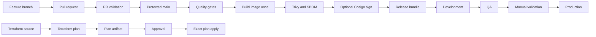

# Platform overview

## Delivery architecture

## Control planes

| Control plane | Responsibility |
|---|---|
| Azure Repos | Protected source, review history, branch policies |
| Azure Pipelines | Template expansion, quality gates, artifact creation, orchestration |
| Azure DevOps Environments | Deployment history, permissions, approvals, checks, exclusive locks |
| Azure service connections | Federated Azure access without a stored client secret |
| ACR | Immutable OCI image and related supply-chain artifacts |
| AKS | Runtime target for the Helm release |
| Azure Key Vault | Runtime secrets and optional Cosign signing key |
| Terraform backend | Remote state with Azure AD authorization and locking |

## Trust boundaries

- Pipeline YAML can request deployment, but environment checks are controlled outside the YAML.
- The release bundle contains a digest and evidence, never a mutable tag as the deployment identity.
- Azure tokens are short lived and available only inside the relevant task.
- Secrets are fetched from Key Vault at runtime and are not written to source control.
- Production requires a release tag, manual validation, and Azure DevOps Environment authorization.
